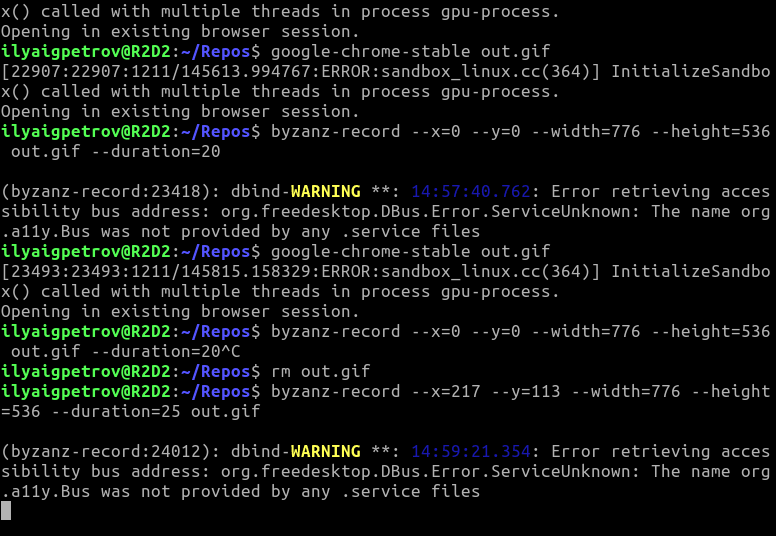

# Blessed Terminal Snowflakes

Let it snow in your terminal.  
Implemented with library [neo-blessed](https://github.com/embark-framework/neo-blessed).

# Howto

1. Install [nodejs](https://nodejs.org).
2. `npm install` in the cloned directory.
3. `node index`

# Demo

